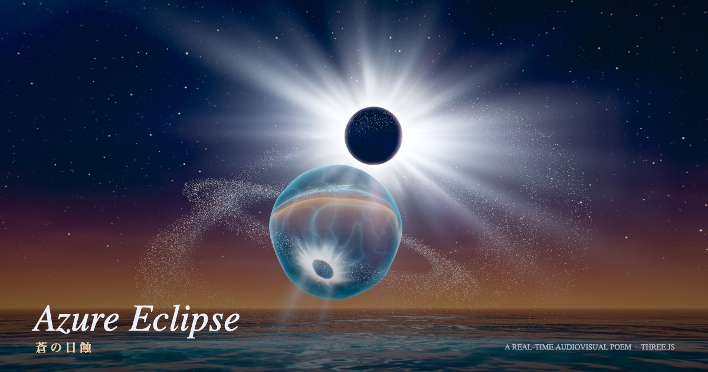

# Azure Eclipse — 蒼の日蝕

水・月・光をテーマにした、約 3 分のリアルタイム・オーディオビジュアル作品（メガデモ）です。
映像も音楽もすべてブラウザ上でリアルタイムに生成します。動画ファイルや音声サンプルは一切使っていません。



## 構成（5 章・76 BPM・56 小節）

| 章 | 小節 | 内容 |
| --- | --- | --- |
| I 宙 Cosmos | 0–8 | 天の川と巨大な月。宇宙から大気圏へ落下し、夜の海へ |
| II 月の出 Moonrise | 8–20 | 月光の道と、波頭に灯る生物発光の海 |
| III 浄化 Purification | 20–32 | 海の光が渦を巻いて昇り、水の球体になる。夜明け |
| IV 日蝕 Eclipse | 32–44 | 月が太陽を覆い、皆既日食。コロナとダイヤモンドリング |
| V 還光 Return | 44–56 | 水球が光を解き放ち、金色の灯が空へ還っていく |

映像側のパラメータは、すべて音楽と同じクロック（`src/client/demo/timeline.ts`）から決定論的に導きます。
そのため、シークしても映像と音楽は常に同期します。

## 技術

- **レンダリング**: Three.js + 自前のマルチパス・パイプライン
  - 手続き的な空（星・天の川・月面・コロナ・紅炎・ダイヤモンドリング・雲）
  - Gerstner 波 12 本の海（距離に応じた LOD、生物発光、クリックで広がる波紋）
  - 2 回屈折と分散で描く水球（実際のボールレンズのように像が倒立する）
  - GPU で状態遷移する 13 万パーティクル
  - ポストエフェクト: CoD:AW 方式のブルーム、ゴッドレイ、アナモルフィックストリーク、レンズゴースト、ACES、グレイン
- **音楽**: Web Audio API によるジェネレーティブ・スコア（パッド、FM ベル、シンギングボウル、潮騒、クワイア、キック）
- **UI**: React 19（章タイトル、タイムライン、キャプチャ、X へのシェア）
- **配信**: Hono on Cloudflare Workers（静的アセットと `/api/*`）
- **ツール**: Bun / TypeScript 7 / Vite 8 / Biome / oxlint

## 開発

```sh
bun install
bun run dev        # http://localhost:5173
bun run check      # biome + oxlint + tsc
bun run build
bun run deploy     # Cloudflare にデプロイ（要 wrangler login）
```

### 便利な URL パラメータ

- `?t=120` — 指定した秒数から再生を開始する
- `?still=131` — 指定した時刻で映像を静止させる（UI なし。撮影や検証用）

### 操作

| キー | 動作 |
| --- | --- |
| Space | 一時停止／再開 |
| ← / → | 10 秒戻る／進む |
| 1–5 | 章へジャンプ |
| M | ミュート |
| C | フレームをキャプチャ（モバイルでは共有シート） |
| F | フルスクリーン |
| クリック／タップ | 海に波紋を立てる（和音に合ったチャイムが鳴る） |
